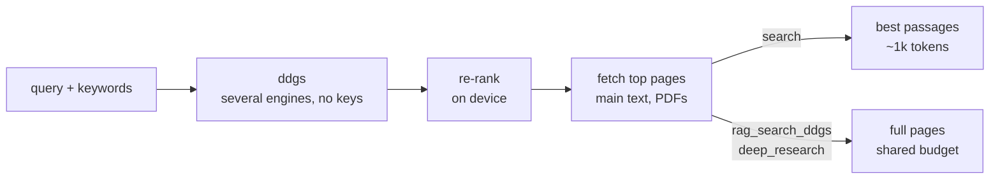

<p align="center">
  <picture>
    <source media="(prefers-color-scheme: dark)" srcset="https://raw.githubusercontent.com/nkapila6/mcpsurfr/main/assets/logo-dark.svg">
    
  </picture>
</p>

<!-- mcp-name: io.github.nkapila6/mcpsurfr -->

<p align="center">Local web search for your LLM over MCP. No API keys, and results are ranked on your machine.<br><em>Formerly <a href="https://github.com/nkapila6/mcpsurfr/tree/main-bak"><code>mcp-local-rag</code></a>.</em></p>

<p align="center">
  <a href="https://pypi.org/project/mcpsurfr/"></a>
  <a href="https://pypi.org/project/mcpsurfr/"></a>
  <a href="https://github.com/nkapila6/mcpsurfr/pkgs/container/mcpsurfr"></a>
  <a href="https://github.com/nkapila6/mcpsurfr/blob/main/LICENSE"></a>
  <a href="https://deepwiki.com/nkapila6/mcpsurfr"></a>
</p>

<p align="center">
  <a href="https://lmstudio.ai/install-mcp?name=mcpsurfr&config=eyJjb21tYW5kIjoidXZ4IiwiYXJncyI6WyJtY3BzdXJmciJdfQ%3D%3D"></a>
  <a href="https://cursor.com/en/install-mcp?name=mcpsurfr&config=eyJjb21tYW5kIjoidXZ4IiwiYXJncyI6WyJtY3BzdXJmciJdfQ%3D%3D"></a>
  <a href="https://insiders.vscode.dev/redirect/mcp/install?name=mcpsurfr&config=%7B%22command%22%3A%22uvx%22%2C%22args%22%3A%5B%22mcpsurfr%22%5D%7D"></a>
</p>

<p align="center"><a href="https://ko-fi.com/X8X51MK4A1"></a></p>



What's in it:

- **No API keys.** Searches go through [ddgs](https://github.com/deedy5/ddgs). Its `auto` mode asks several engines at once and skips blocked ones.
- **Ranked locally.** A small MobileBERT model on plain numpy re-ranks results, so only the best pages get fetched.
- **Clean text.** Pages are fetched with browser impersonation, and only the main content is kept: no menus, cookie banners or footers. Code blocks and tables keep their lines. PDFs are read too (text layer, first 50 pages). The same page under two URLs comes back once.
- **Passages instead of pages.** `search` returns just the paragraphs that answer the question, about a tenth of the tokens, and `deep_research` can do the same per search term. When nothing matches well, `search` can ask you whether you want the full pages instead.
- **Reads the sites that block scrapers.** Stack Overflow and the other Stack Exchange sites, Wikipedia and GitHub go through their free APIs: questions with the accepted answer first, articles by section, READMEs and raw files.
- **Titles and dates.** Every page and passage carries its title, and its publish date when the page or news result has one.
- **Says what it left out.** Results list skipped pages with a reason (blocked, JavaScript-only, duplicate...) and the search snippet for each, so a Reddit thread or an msn.com article still says something. Cut pages are marked `truncated`, and fallbacks and engine failures show up as `warnings`. Google blocks often, so it falls back to `auto` on its own.
- **Quick on repeats.** Searches and pages are kept for five minutes, so a follow-up call on the same pages doesn't fetch them again.
- **Brings its own guide.** It serves a skill and a `research` prompt, so clients pick up how to use it without setup.

| Tool | Use it for |
|---|---|
| `search` | Start here: returns only the relevant passages. Pass `keywords` for better hits |
| `rag_search_ddgs` | Full pages as text (the original mode). Takes a `backend` |
| `deep_research` | Several search terms across backends, merged and de-duplicated. `passages: true` returns only the relevant passages per term |
| `read_url` | One page you already have the link for. Pass a `query` to get only the passages that answer it |

The search tools also take `recency` (`day`, `week`, `month`, `year`), `region` (`uk-en`, `de-de`...), `include_domains` / `exclude_domains`, and `news: true` for dated news articles.

The old `rag_search_google`, `deep_research_ddgs` and `deep_research_google` presets are hidden by default. [Options](#options) says why and how to turn them back on.

Backends: `auto` (default), `brave`, `duckduckgo`, `google`, `grokipedia`, `mojeek`, `startpage`, `wikipedia`, `yahoo`. `auto` and `brave` are the dependable ones. With `news: true`: `auto`, `bing`, `duckduckgo`, `yahoo`.

## How it compares

Other keyless MCP servers ([mcp-searxng](https://github.com/ihor-sokoliuk/mcp-searxng), [duckduckgo-mcp-server](https://github.com/nickclyde/duckduckgo-mcp-server), [open-webSearch](https://github.com/Aas-ee/open-webSearch), the official [fetch](https://github.com/modelcontextprotocol/servers/tree/main/src/fetch) server) hand the model snippets or whole pages. Hosted APIs like Tavily, Exa and Brave do cut pages down to the useful parts, but they need a key and do it on their servers. mcpsurfr does that part on your machine:

- picks passages with BM25 on the query plus keywords the model supplies, and an on-device embedder for ties and paraphrases
- drops near-duplicate pages and shares one text budget across the rest
- tells the model what it skipped and why, and can ask you before falling back to full pages

What it doesn't do: JavaScript-only pages, OCR for scanned PDFs, image search.

## Install

From PyPI with [uv](https://docs.astral.sh/uv/):

```json
{
  "mcpServers": {
    "mcpsurfr": {
      "command": "uvx",
      "args": ["mcpsurfr"]
    }
  }
}
```

`uvx` keeps using the version it cached first. Use `"mcpsurfr@latest"` to pick up new releases on every start (about a second slower), or `"mcpsurfr@<version>"` to pin one. `uv tool install mcpsurfr` works too, with `"command": "mcpsurfr"`.

Or with Docker (amd64 and arm64):

```json
{
  "mcpServers": {
    "mcpsurfr": {
      "command": "docker",
      "args": ["run", "--rm", "-i", "--init", "ghcr.io/nkapila6/mcpsurfr:latest"]
    }
  }
}
```

### Options

All settings are optional. These configs set each one to its default, so change only what you need. With uvx they go in `env`:

```json
{
  "mcpServers": {
    "mcpsurfr": {
      "command": "uvx",
      "args": ["mcpsurfr"],
      "env": {
        "MCPSURFR_MAX_CHARS": "40000",
        "MCPSURFR_DEEP_RESEARCH_MODE": "pages",
        "MCPSURFR_CACHE_TTL": "300",
        "MCPSURFR_LEGACY_TOOLS": "0"
      }
    }
  }
}
```

| Variable | Default | What it does |
|---|---|---|
| `MCPSURFR_MAX_CHARS` | `40000` | Text budget per call when returning full pages (`rag_search_ddgs`, `deep_research`, `read_url` without a query), shared across pages. ~4 chars per token |
| `MCPSURFR_DEEP_RESEARCH_MODE` | `pages` | What `deep_research` returns when a call doesn't say: `pages` (full text) or `passages` (only what answers each term, about a tenth of the tokens) |
| `MCPSURFR_CACHE_TTL` | `300` | Seconds searches and fetched pages are reused. `0` turns the cache off. News searches are never cached |
| `MCPSURFR_LEGACY_TOOLS` | `0` | `1` brings back `rag_search_google`, `deep_research_ddgs` and `deep_research_google`, for prompts or workflows that still call them by name |

Why the legacy tools are off: they're just `rag_search_ddgs` and `deep_research` with a fixed `backend`, which the search tools now take themselves. Each tool's name, description and parameters get sent to the model in every chat whether it's used or not, so three duplicates cost context for nothing and give the model more ways to pick the wrong one.

With Docker, `env` only reaches the `docker` command, not the container, so the settings go in `args` with `-e`, before the image name. The same defaults:

```json
{
  "mcpServers": {
    "mcpsurfr": {
      "command": "docker",
      "args": [
        "run", "--rm", "-i", "--init",
        "-e", "MCPSURFR_MAX_CHARS=40000",
        "-e", "MCPSURFR_DEEP_RESEARCH_MODE=pages",
        "-e", "MCPSURFR_CACHE_TTL=300",
        "-e", "MCPSURFR_LEGACY_TOOLS=0",
        "ghcr.io/nkapila6/mcpsurfr:latest"
      ]
    }
  }
}
```

Not sure where your config lives? See the [MCP quickstart](https://modelcontextprotocol.io/quickstart/user). Tested with Claude Desktop, Claude Code, Cursor and Goose.

**Coming from `mcp-local-rag`?** Your old config keeps working, since the old URL redirects and the `mcp-local-rag` command still exists. Switching to the config above gets you the new name and drops the `--python=3.10` pin (3.10 is end of life as of October 2026). If your prompts call `rag_search_google` or `deep_research_google` by name, set `MCPSURFR_LEGACY_TOOLS` to `1` (see [Options](#options)).

## Skill and prompt

The [`mcpsurfr-search`](https://github.com/nkapila6/mcpsurfr/blob/main/src/mcpsurfr/skills/mcpsurfr-search/SKILL.md) skill tells the model which tool and backend to pick and how to cite. The server serves it as `skill://mcpsurfr-search/SKILL.md`, so most clients need nothing extra. To add it to Claude Desktop by hand: **Settings → Skills → Add from folder**, then pick `src/mcpsurfr/skills/mcpsurfr-search/`.

The `research(topic)` prompt plans a few search terms, runs `deep_research` and writes a cited summary.

## Example

Asking Claude Desktop about something newer than its training data:


---

[Security audit by MseeP](https://mseep.ai/app/nkapila6-mcp-local-rag) · Issues and PRs welcome · MIT licensed · [Buy me a coffee](https://ko-fi.com/X8X51MK4A1) if it helps you
